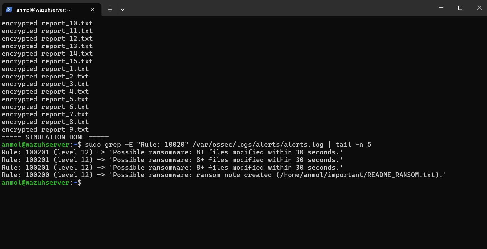
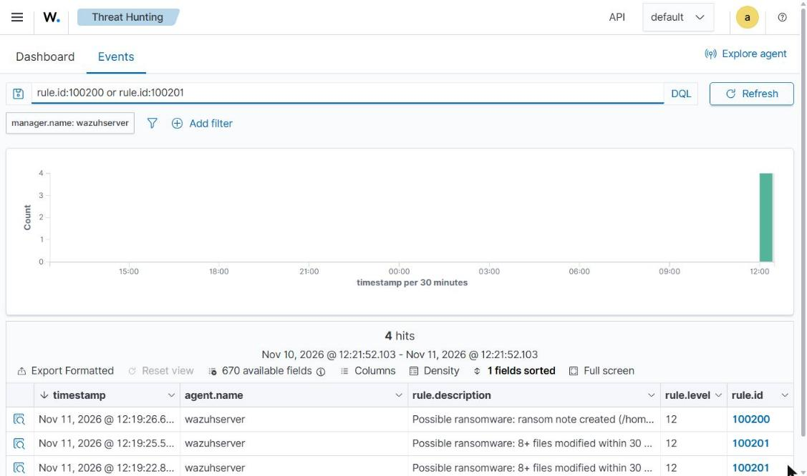
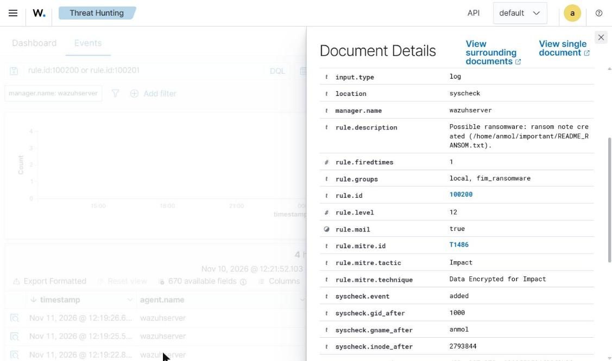
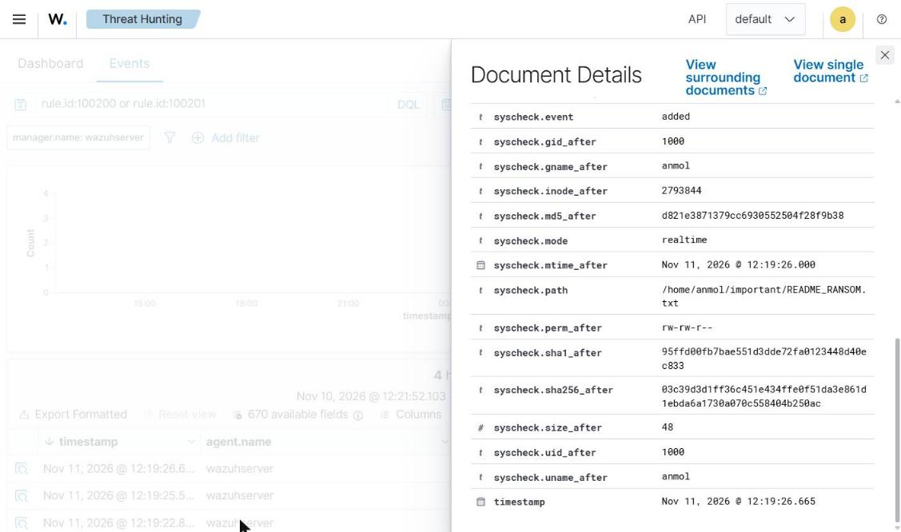

# Wazuh FIM Ransomware Detection Lab

Detecting ransomware-like behaviour with **Wazuh File Integrity Monitoring (FIM)**: mass file encryption and a dropped ransom note, caught in real time by custom correlation rules mapped to MITRE ATT&CK.

> The simulation in this repo only overwrites dummy text files in a test folder. Run it **only** on a lab VM you own.

Part 2 of my Wazuh home-lab series. Part 1: [wazuh-bruteforce-detection-lab](https://github.com/AnmolNisar/wazuh-bruteforce-detection-lab)

## What this project shows

| Skill | How it's shown |
|---|---|
| File Integrity Monitoring | Real-time (`inotify`) monitoring of a folder with `report_changes` and full checksums |
| Correlation rules | 8+ file modifications (or deletions) within 30 seconds raises one level-12 alert |
| Pattern detection | Any new file named `*RANSOM*` in a monitored folder raises a level-12 alert |
| MITRE ATT&CK mapping | T1486 Data Encrypted for Impact, T1485 Data Destruction |
| Forensics | Each FIM alert carries path, owner, size and MD5/SHA1/SHA256 hashes |
| Safe attack simulation | Bash script that mimics encryption and drops a ransom note |

## How it works

```
 ransomware_sim.sh                 Wazuh (syscheck / FIM)                 Custom rules
 -----------------                 ----------------------                 ------------
 overwrite 15 files  ------------> rule 550 "file modified" x15 --------> 100201 (8+ in 30 s)  level 12  T1486
 drop README_RANSOM.txt ---------> rule 554 "file added"    ----------> 100200 (RANSOM note) level 12  T1486
 (cleanup) delete files ---------> rule 553 "file deleted"  x15 --------> 100202 (8+ in 30 s)  level 12  T1485
```

## Lab

Same single-VM lab as Part 1: Ubuntu Server 24.04 in VirtualBox running Wazuh 4.14 all-in-one. The Wazuh manager monitors its own filesystem, so no extra agent is needed. The same config works on any Wazuh agent.

## Setup

1. **Create test files:**
   ```bash
   bash attack-sim/create_test_files.sh ~/important
   ```

2. **Turn on real-time FIM for the folder:** append `config/fim-ossec-snippet.xml` to `/var/ossec/etc/ossec.conf` (change the path to your folder).

3. **Add the rules:** append the `<group>` from `rules/local_rules_fim.xml` to `/var/ossec/etc/rules/local_rules.xml`.

4. **Restart and wait for the baseline scan:**
   ```bash
   sudo systemctl restart wazuh-manager
   sudo grep -i "real-time" /var/ossec/logs/ossec.log | tail -n 1
   # ... Real-time file integrity monitoring started.
   ```

## Run the simulation

```bash
bash attack-sim/ransomware_sim.sh ~/important
sudo grep -E "Rule: 10020" /var/ossec/logs/alerts/alerts.log | tail -n 5
```

Expected:
```
Rule: 100201 (level 12) -> 'Possible ransomware: 8+ files modified within 30 seconds.'
Rule: 100200 (level 12) -> 'Possible ransomware: ransom note created (/home/anmol/important/README_RANSOM.txt).'
```

Dashboard: Threat intelligence -> Threat Hunting -> Events, query `rule.id:100200 or rule.id:100201`.

Reset with `bash attack-sim/cleanup.sh ~/important` (the mass delete also triggers rule 100202).

## Custom rules

| ID | Level | Detects | Based on | MITRE |
|---|---|---|---|---|
| 100200 | 12 | File with `RANSOM` in its name created | 554 (file added) | T1486 |
| 100201 | 12 | 8+ files modified within 30 s | 550 (checksum changed) | T1486 |
| 100202 | 12 | 8+ files deleted within 30 s | 553 (file deleted) | T1485 |

## Results

**Simulation run: Wazuh fires the custom ransomware rules**



**Alerts in the Wazuh dashboard (level 12)**



**MITRE ATT&CK mapping: T1486, Impact, Data Encrypted for Impact**



**FIM forensic data: path, owner, real-time mode and file hashes**



## What I learned

- How Wazuh FIM works: a baseline scan records each file's hashes and attributes, then `realtime="yes"` uses inotify to report changes within seconds.
- How to turn many low-severity FIM events into one high-severity alert with `frequency`, `timeframe` and `if_matched_sid`.
- Why behaviour-based detection matters: the rules catch the *pattern* (mass changes, ransom note), not a specific malware sample.
- FIM alerts double as forensic evidence: hashes, size, owner and timestamps for every affected file.
- Tuning trade-offs: thresholds that are too low cause false positives during normal bulk edits; scoping to sensitive folders keeps noise down.

## Ideas to extend

- Add an active response that kills the offending process or isolates the host.
- Exclude noisy paths with `<ignore>` and add `whodata` to record which user and process changed each file.
- Forward level-12 alerts to Slack/Discord.

## Repo layout

```
rules/       custom FIM ransomware rules
config/      ossec.conf snippet for real-time FIM
attack-sim/  create test files, run the simulation, clean up (lab only)
docs/        screenshots
```

## License

MIT
